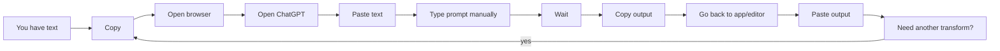

<h1>Ord</h1>

Turns reusable prompt templates into a fast command-line workflow you can trigger from anywhere.

[[_TOC_]]

## What it does

Ord is built around a simple loop:

1. Copy text.
2. Press your Ord keybind.
3. Paste the improved result.

or:

1. Copy text.
2. Press your Ord keybind.
3. See the results in your default web browser.

## Why?

### Old workflow



### New workflow with Ord


## Templates

Templates are Markdown files with YAML front matter plus placeholders.

```md
---
description: Correct grammar and spelling
---

Correct grammar and spelling, and improve clarity where wording is awkward.

Text:
{{:text}}
```

On first run, if no templates exist, `ord` offers to install example templates automatically.

Built-in starter templates include:

- `grammar`
- `shorten`
- `summarize`
- `summarize_logs`
- `eli5`
- `definition`
- `commit_message`

## Examples

### Grammar fix from clipboard, then auto-copy result

```bash
ord run grammar -f text -c -n
```

### Generate commit message from staged diff

```bash
ord run commit_message text="$(git diff --staged)"
```

### Summarize clipboard text and open rendered Markdown in browser

```bash
ord run summarize -f text -b
```

### Git commit messages from staged diff

Save as `~/bin/smart_commit` (or any directory in your `$PATH`) and `chmod +x`.

Note: For Unix-like systems (Linux, macOS). Windows users can run via WSL or adapt to PowerShell.

```bash
#!/bin/bash
set -e

if git diff --cached --quiet; then
    echo "No staged changes."
    exit 1
fi

msg=$(ord run commit_message text="$(git diff -U20 -W --stat --staged)")

echo "Proposed commit message:"
echo "------------------------"
echo "$msg"
echo "------------------------"

read -p "Commit (y), edit (e), or cancel (n)? " c

case "$c" in
    [Yy]) git commit -m "$msg" ;;
    [Ee]) git commit -e -m "$msg" ;;
    *)    echo "Cancelled." ;;
esac
```

### More ideas you can automate

- PR description drafts: `ord run summarize text="$(git diff main...HEAD)"`
- Log triage: `ord run summarize_logs text="$(tail -n 500 app.log)" -b`
- "Explain this fast": `ord run eli5 -f text -b`
- Tighten writing before sending: `ord run shorten -f text -c`

## CLI

### Core commands

- `ord run [OPTIONS] [TEMPLATE] [KEY=VALUE]...`
- `ord info [TITLE]`
- `ord list`

### `ord run` options

- `-f, --from-clipboard <KEY>`: fill one placeholder from clipboard.
- `-c, --copy-to-clipboard`: copy output to clipboard.
- `-n, --notify[=<TYPE>]`: desktop notification (`status` or `content`).
- `-b, --browser[=<FORMAT>]`: open output in browser (`markdown` or `plain`).
- `--no-newline`: print without trailing newline.

## Providers

Ord currently supports these LLM providers:

- OpenRouter
- Anthropic
- OpenAI
- Ollama

## Installation

### Method 1: Manual

```bash
git clone https://github.com/EddieBrunstedt/ord
cd ord
cargo install --path .
```

### Method 2: AUR (Arch-based Linux)

```bash
paru -S ord
# or
git clone https://aur.archlinux.org/ord.git && cd ord && makepkg -si
```

## Configuration

Ord stores config and templates under `ord/` in your OS config directory:

| OS      | Location                                    |
| ------- | ------------------------------------------- |
| Linux   | `~/.config/ord/` or `$XDG_CONFIG_HOME/ord/` |
| macOS   | `~/Library/Application Support/ord/`        |
| Windows | `%APPDATA%\ord\`                            |

`config.toml`:

```toml
provider = "anthropic"       # "anthropic", "ollama", "openai", or "openrouter"
model = "claude-sonnet-4-5"  # any model your provider supports
max_tokens = 4096            # optional
```

If `config.toml` does not exist, Ord creates it with defaults on first run.

Provider environment variables:

- `ANTHROPIC_API_KEY`
- `OPENAI_API_KEY`
- `OPENROUTER_API_KEY`

For Ollama, Ord uses the default host automatically (`http://localhost:11434`).
Override with:

```bash
export OLLAMA_HOST="http://192.168.1.100:8080"
```
